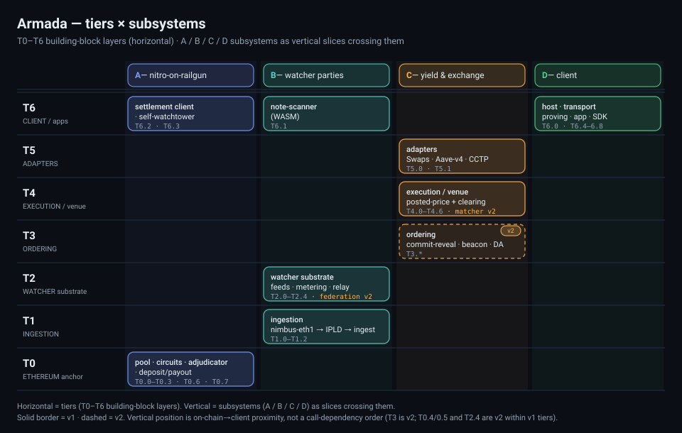

# 5. Building Block View

arc42 §5 · **2026-10-20**

This section gives the static decomposition of the system. **Level 1** is the seven **tiers** (T0–T6) — horizontal building-block layers running from the on-chain anchor up to the client — and each tier's whitebox detail lives in its own doc (`T0-ethereum-anchor.md` … `T6-client-apps.md`). The four **subsystems** — work packages A/B/C/D ([§0](./00-work-packages.md)) — are the **vertical slices**: each owns `T#.#` items across several tiers and consumes the rest across ICDs. Tiers and subsystems are two axes over one item set, and the **item registry** below is the single model of record. Every buildable item carries one `T#.#` id with its **status**, read from the code, not from a plan.

The ship-armada repos — `armada-poc`, `armada-circuits`, `armada-deployments`, `armada-nitro`, `armada-sdk`, `armada-client`, `armada-relayer`, `armada-interface` — already carry the pool, the circuits, the adjudicator, the client SDK and the web app. This registry states what each item is, cites the code, and marks what remains as a plan. See `labbook/2026-10-19-docs-versus-code.md` for the audit and the operator rulings that this section follows.

## Level 1 — the tier stack

```
 tier                    building blocks                                    owner    status
 ------------------------------------------------------------------------------------------
 T6  CLIENT / apps       web app (built) · note-scanner · prover · wallet   A·B·D    partly built
 T5  ADAPTERS            CCTP (built) · Aave-v4 yield (built) · Swaps        C        partly built
 T4  EXECUTION / venue   posted-price venue + clearing                       C        not built
 T3  ORDERING            commit-reveal + beacon · epoch set-agreement · DA   C        not built
 T2  WATCHER substrate   proof verification (nimbus proxy) · relay fee       B        in progress
 T1  INGESTION           nimbus verified proxy over execution + beacon data  B        in progress
 T0  ETHEREUM anchor     pool · circuits · adjudicator · governance          A        built/partly built
```

Read this as a layered building-block view: the tiers are horizontal layers, and the subsystems (A/B/C/D) are vertical slices that cross them. The `owner` column is each tier's primary subsystem; **T6 is shared**. Vertical position is on-chain-to-client proximity. The `status` column reports what the code holds today, and each item in the registry below carries its own status.

<p></p>

| Tier | Responsibility | Owner(s) | Whitebox |
|---|---|---|---|
| **T0** Ethereum anchor | On-chain pool, circuits, adjudicator, governance and revenue contracts | A | [`T0-ethereum-anchor.md`](./T0-ethereum-anchor.md) |
| **T1** Ingestion | The proof path: the nimbus verified proxy over execution and beacon data | B | [`T1-ingestion.md`](./T1-ingestion.md) |
| **T2** Watcher substrate | A cache the proxy re-verifies, with relay fee and federation attestation | B | [`T2-watcher-substrate.md`](./T2-watcher-substrate.md) |
| **T3** Ordering (plan) | Provably-fair sequencing for a future matcher | C (plan) | [`T3-ordering.md`](./T3-ordering.md) |
| **T4** Execution / venue (plan) | Posted-price RFQ clearing | C (plan) | [`T4-execution-venue.md`](./T4-execution-venue.md) |
| **T5** Adapters | CCTP, Aave-v4 yield, and a routing interface; no Swaps contract | C | [`T5-adapters.md`](./T5-adapters.md) |
| **T6** Client / apps | The `armada-interface` web app, note-scanner, prover, and SDK | A · B · D | [`T6-client-apps.md`](./T6-client-apps.md) |

## Item registry (the single model)

Facets: **status** (`built` · `partly built` · `not built` · `in progress` — on an unmerged branch) and the code location that proves it. A `release` of `v1` was the shipping plan when an item had no code; where the code already stands, the registry drops the plan label and states the fact.

### T0 · Ethereum anchor

The pool, the circuits, the adjudicator and the deposit/payout boundary already exist. `ArmadaNitroAdjudicator` carries both the adjudication and the deposit/payout roles together (ruling 1, `labbook/2026-10-19-docs-versus-code.md`).

| id | item | status | code |
|---|---|---|---|
| T0.0 | Shielded pool — `PrivacyPool`, routed by `delegatecall` to four modules (`ShieldModule`, `TransactModule`, `MerkleModule`, `VerifierModule`); no proxy; a 16-deep commitment tree per `treeNumber`; a token blocklist (USDC exempt); a shield fee (`MAX_SHIELD_FEE_BPS = 1000`, deployed at 50 bps) | built | `armada-poc@102f17b8:contracts/privacy-pool/PrivacyPool.sol:20,39,330-336`, `contracts/privacy-pool/modules/MerkleModule.sol:13` |
| T0.1 | Circuits + trusted setup — one `Transact(N,M)` circom template, 19 `(nIn,nOut)` shapes; Groth16; Phase-1 reuses the community Perpetual Powers of Tau; the Phase-2 ceremony is open, not finished (`v1.0.0-ceremony` manifest lists every shape `"status": "open"`, no beacon) | partly built | `armada-circuits@ef2682f:src/operations/Transact.circom`; tag `v1.0.0-ceremony:ceremony/manifest.json` |
| T0.2 | Nitro adjudicator — `ArmadaNitroAdjudicator` extends `go-nitro`'s `NitroAdjudicator`; six commits patch the vendored contracts (EIP-1271 participants, a guarantee-check fix, measured-balance deposit crediting, an asset allow-list, a per-channel reentrancy lock, `SafeERC20` payout), so this is a patched adjudicator, not a vanilla deploy. It also carries the deposit/payout boundary: `depositFromNote` funds a channel from a shielded note, and a `SHIELD`-type allocation pays a note back out in `_executeSingleAssetExit` | partly built | `armada-nitro@55939ef:src/ArmadaNitroAdjudicator.sol:93-108,136-150` |
| T0.4 | Registry + bond contract — venue/party bonding | not built | — |
| T0.5 | Sequencing-cert + fraud-proof verifier | not built | — |
| T0.6 | Native channelized commitment — amount-privacy-in-play; a circuit change (optional) | not built | — |
| T0.7 | Anonymity-set strategy — grow the crowd with the pool's own deposits; the wallet offers a move from Railgun, with its security costs shown before confirmation (ADR-0006, T6.7) | strategy | — |
| — | Governance and revenue contracts — `ArmadaGovernor` (UUPS, five proposal types, a Security Council veto), `ArmadaTreasuryGov`, `TreasurySteward`, `ArmadaToken` (ERC20Votes, 12M fixed supply), `ArmadaCrowdfund`, `ArmadaWindDown`, `ArmadaRedemption`, `AdapterRegistry`, `RevenueCounter`, `RevenueLock`, `RevenueReserveDistributor` | built | `armada-poc@102f17b8:contracts/governance/`, `contracts/crowdfund/` |

### T1 · Ingestion

The proof path is the nimbus verified proxy, not a nimbus-eth1 state-diff emitter into IPLD (ruling 8, brief §4). `armada-nitro`'s vendored `go-nitro` and `PrivacyPool` need no change for this path; the proxy verifies RPC answers upstream of the client.

| id | item | status | code |
|---|---|---|---|
| T1.0 | Proof source — the nimbus verified proxy (`status-im/nimbus-eth1`): a native binary, `libverifproxy.a` with C/Go bindings, and a WASM build; it anchors headers to a beacon light client and verifies storage with EIP-1186 proofs | in progress (upstream, unintegrated) | `nimbus-eth1:engine/blocks.nim:105-128`, `engine/accounts.nim:26-125`, `Makefile:346-398` |
| T1.1 | Inclusion and completeness — the proxy fetches `eth_getBlockReceipts` for a block, rebuilds the receipt trie, and rejects the block if the root disagrees with the header; this proves one log and the completeness of the block's logs. `eth_getLogs` ranges are not used, because an omitted log is undetectable in a range | in progress (upstream, unintegrated) | `nimbus-eth1:engine/receipts.nim:53-57,132-173` |
| T1.2 | Fixturenet patch — the proxy's genesis-parameter loader hard-codes `sepolia`/`hoodi`; a custom-network patch is needed to point it at the armada-nitro fixturenet's lighthouse genesis | not built | `nimbus-eth1:engine/genesis_params.nim:48-70` |

### T2 · Watcher substrate

`watcher-ts` is the indexer, not a proof-carrying feed; it runs server-side only, on Postgres, and serves an optional, unverified cache. A client re-verifies anything it reads from the cache through the proxy (ruling 7, brief §4).

| id | item | status | code |
|---|---|---|---|
| T2.1 | Relay fee — `armada-relayer`'s actor charges a flat USDC fee from a gas estimate | partly built (different mechanism) | `armada-relayer:relayer-v2/.../fee-calculator.ts` |
| T2.2 | Indexer — `watcher-ts` on a Postgres backend, server-only; today's live indexer is `armada-relayer`'s Ponder/Postgres watcher | not built (watcher-ts); built (Ponder, to be replaced) | `watcher-ts@18ca4e1a:packages/util/src/database.ts:98` |
| T2.3 | Transport — no Waku, no libp2p anywhere in the client/relayer/interface repos | not built | — |
| T2.4 | Federation + bond — independent watchers sign a snapshot CID; a client accepts a CID that several of them sign | not built (design only) | — |

### T3 · Ordering (plan)

| id | item | status | code |
|---|---|---|---|
| T3.0 | Commit-reveal sequencer + randomness beacon | not built | — |
| T3.1 | Epoch set-agreement / DA | not built | — |
| T3.2 | Attestation — sequencing certs / inclusion receipts | not built | — |

### T4 · Execution / venue (plan)

No venue contract and no matcher exist in `armada-poc`. These items stay a plan.

| id | item | status | code |
|---|---|---|---|
| T4.0 | Posted-price contract | not built | — |
| T4.1 | Quote/settle ForceMove app | not built | — |
| T4.2 | Venue solver | not built | — |
| T4.3 | Fee-split allocation | not built | — |
| T4.4 | ETH yield — shielded wstETH note; any non-blocklisted ERC-20 can already be shielded, so no new contract is needed | built (as a consequence of T0.0's design) | `armada-poc@102f17b8:contracts/privacy-pool/modules/ShieldModule.sol:258` |
| T4.5 | USDC yield — LP-buffered Aave rail | not built | — |
| T4.6 | ex_net matcher + LP vault | not built | — |

### T5 · Adapters

| id | item | status | code |
|---|---|---|---|
| T5.0a | CCTP — `PrivacyPool`/`PrivacyPoolClient`/`CCTPHookRouter` implement cross-chain shield/unshield over CCTP v2 | built | `armada-poc@102f17b8:contracts/privacy-pool/PrivacyPool.sol:166,196,224` |
| T5.0b | Aave-v4 yield — `ArmadaYieldAdapter`/`ArmadaYieldVault`, through the pool's own `adaptContract`/`adaptParams` binding; not a Railgun RelayAdapt/Cookbook recipe, because no RelayAdapt contract exists in this codebase | built | `armada-poc@102f17b8:contracts/yield/ArmadaYieldAdapter.sol:27-40` |
| T5.0c | Swaps | not built | — |
| T5.1 | Routing interface — how a future T4 venue would route to the adapters | not built | — |

### T6 · Client / apps

`armada-client`, meant to host a React Native wallet, has no application code. The live client is `armada-interface`, a React 19 + Vite web app, wired to `armada-sdk`.

| id | item | status | code |
|---|---|---|---|
| T6.0 | Wallet base — `armada-interface` holds keys in browser memory (`keyManager.ts`); no BIP-39/HD custody, no secure enclave, no React Native code | built, web only | `armada-interface:src/lib/shielded/keyManager.ts` |
| T6.1 | Note-scanner + prover — browser note scanning and a `snarkjs` Web Worker Groth16 prover | built | `armada-interface:src/lib/shielded/sync.ts,sdk-prover.ts`; `armada-sdk@db5757f:src/prover/index.ts` |
| T6.2 | Settlement client — drives `PrivacyPool` shield/transact calls; no code drives an armada-nitro channel lifecycle yet | partly built | `armada-interface:src/features/{shield,transfer-shielded,unshield}/handler.ts` |
| T6.3 | Self-hosted watchtower — `armada-nitro`'s e2e gate harness has a watchtower (`env/gates/watchtower/watch.ts`); no client watchtower exists | not built (client); built (test harness only) | `armada-nitro@55939ef:env/gates/watchtower/watch.ts` |
| T6.4 | Address rotation + loyalty keys | not checked | — |
| T6.5 | Mobile transport — one TypeScript client stack on four targets: Linux server, browser, iOS, Android (`armada-client` `docs/SPEC.md`); `libverifproxy.a` has no upstream iOS/Android build yet | not built | `armada-client@78a8fdc:docs/SPEC.md` |
| T6.6 | Groth16 mobile proving — a browser Web Worker prover exists (T6.1); no native mobile (rapidsnark/mopro) prover | partly built | see T6.1 |
| T6.7 | Armada-branded app + SDK wiring; wallet move from Railgun (the security costs are in T6.7 and §8.2) | built (app); move from Railgun not built | `armada-interface` |
| T6.8 | Identity — optional Self zk-passport attestation | not built | — |

*Decisions that shaped these items: [§9 ADRs](./09-architecture-decisions.md). Recurring concerns spanning tiers: [§8 cross-cutting concepts](./08-crosscutting-concepts.md). Status audit: `labbook/2026-10-19-docs-versus-code.md`, `labbook/2026-10-19-unified-stack-and-verified-note-sync.md`, `labbook/2026-10-19-nimbus-verified-proxy-proofs.md`.*
