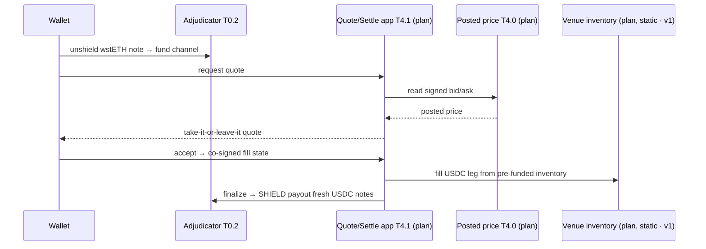
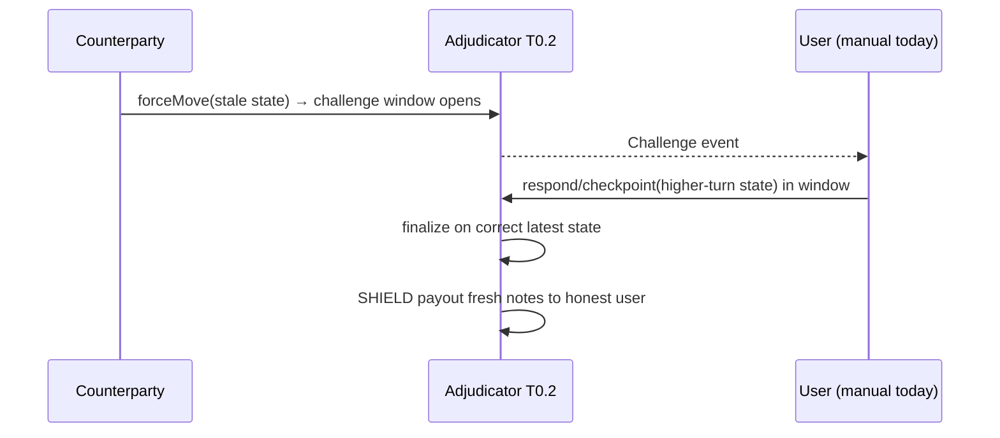
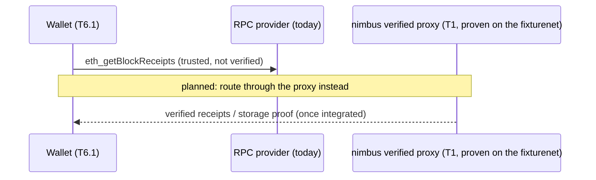

# 6. Runtime View

arc42 §6 · 2026-10-20

Four scenarios show how the §5 building blocks collaborate at run time. Each names the
`T#.#` items involved; the [§5 registry](./05-building-block-view.md) is authoritative
for ids and status. Two scenarios run on code that exists today (§6.1's contract path,
§6.3's dispute machinery); two describe a plan with no code yet (§6.2's venue, most of
§6.4's feed). Every scenario shares the spine construction — *notes in → normal Nitro →
notes out* ([ADR-0004](./09-architecture-decisions.md#adr-0004)) — now one merged
`ArmadaNitroAdjudicator` contract (T0.2), not two.

## 6.1 Shield & settle — nitro-on-railgun happy path

The contract-level path. A user shields value, funds a channel from a note, plays
cooperatively off-chain, and exits to fresh notes.

```mermaid
sequenceDiagram
  participant W as Wallet
  participant P as Pool T0.0
  participant N as Adjudicator T0.2
  W->>P: shield (T6.6 Groth16 proof)
  W->>N: depositFromNote → fund channel (public amount)
  W-->>N: off-chain ForceMove states
  W->>N: cooperative close → outcome
  N->>P: SHIELD payout shields fresh notes
  W->>W: scan (RPC today; T1 proxy once integrated)
```

1. **Shield.** `armada-interface`'s browser prover (T6.1) generates a Groth16 proof
   against `armada-circuits`' build artifacts and calls the pool's shield entry point
   (T0.0, built). Custody remains a shielded note throughout.
2. **Deposit / unshield-in.** `ArmadaNitroAdjudicator.depositFromNote` unshields the
   note and uses its value to fund a Nitro channel (T0.2, built). **This is the one
   public boundary amount.** The contract records the consumed nullifier and the
   funded `channelId`.
3. **Off-chain play.** Counterparties exchange signed ForceMove states over the
   channel; this is a patched `go-nitro` state machine with no circuits involved
   (T0.2). No Armada repo drives this lifecycle from a client today: `armada-interface`
   and `armada-sdk` have no open/fund-from-note, propose/accept, or close code (T6.2,
   partly built).
4. **Cooperative close.** When both sides agree, a co-signed final state finalizes
   without opening a challenge window.
5. **Payout / shield-out.** A `SHIELD`-type allocation in `_executeSingleAssetExit`
   shields the channel outcome into fresh notes (T0.2). Settlement returns to notes,
   not public keys.
6. **Scan.** `armada-interface`'s note-scanner (T6.1) trial-decrypts locally today
   against whatever RPC it is configured with. It does not yet verify reads through the
   nimbus verified proxy (T1); that integration has not shipped.

→ boundary detail §5 T0.2; proof path §5 T1; read-path privacy §8.

## 6.2 Private yield→USDC swap

This is a **plan, not built**. It describes a shielded ETH-yield note (wstETH) swapped
to shielded USDC at a posted price, with custody retained throughout
([ADR-0007](./09-architecture-decisions.md#adr-0007): RFQ posted-price venue). No
venue, quote/settle app, or price-setter contract exists in `armada-poc` (T4.0, T4.1 —
not built).



1. **Note → channel.** The wallet would unshield a shielded wstETH note into
   `depositFromNote`, funding a channel at the one public boundary amount (T0.2, built).
   wstETH is already shieldable as any non-blocklisted ERC-20 note (T4.4, built as a
   consequence of T0.0); no new contract is needed for the note itself.
2. **Quote.** The wallet would request a quote. The plan calls for a quote/settle
   ForceMove app (T4.1) reading a signed posted bid/ask from a `priceSetter`-gated
   contract (T4.0). Neither exists.
3. **Settle.** On acceptance, the plan calls for the quote/settle app to advance
   `propose-quote → accept → fill → settle` to a co-signed fill state, taking the user
   leg (wstETH) out and the venue leg (USDC) in, with a missing settlement receipt
   forcing a close to the pre-fill state. Not built.
4. **Fill from inventory.** The plan calls for the venue to fill the USDC leg from a
   pre-funded static inventory at the posted price in v1, with no market-making, no
   internalization, and no hedge. The automated solver (T4.2) is a later plan item.
5. **Payout → fresh USDC notes.** A finalized channel would route its outcome through
   the SHIELD payout path (T0.2, built), shielding fresh USDC notes with no linkage
   back to the deposit note beyond the boundary amount.
6. **Clearing & fee-split.** The plan calls for the trade and the venue's fee to clear
   the same way, splitting value across user/protocol/integrator in the channel
   allocation (T4.3, not built).

→ plan detail §5 T4; adapters that already exist (CCTP, Aave-v4 yield) §5 T5.

## 6.3 Dispute / force-close

The safety scenario. A counterparty tries to steal by force-closing an old state that
favors them while the user is offline. The dispute machinery exists on-chain (T0.2,
built); the client side that would defeat the attempt automatically does not (T6.3, not
built).



1. **Stale-state challenge.** The counterparty submits a superseded state via
   `forceMove` on `ArmadaNitroAdjudicator`, opening a challenge window that will
   finalize the stale state if left unanswered. The challenge/dispute machinery is
   owned by T0.2 and is built and unmodified in its ForceMove logic beyond the six
   patches already noted in §5 T0.2.
2. **Event seen.** The adjudicator emits a `Challenge` event. No Armada client watches
   for this event today; `armada-nitro`'s e2e gate harness has a watchtower
   (`env/gates/watchtower/watch.ts`) that exercises this path in tests, but it is not a
   deployed service (T6.3).
3. **Response.** A user who notices the challenge — manually today, since no automated
   watchtower exists — would submit their higher-turn co-signed state through
   `respond`/`checkpoint` within the window (T0.2, built).
4. **Correct finalize → payout.** The adjudicator finalizes on the correct latest
   state, and the SHIELD payout path shields that outcome into fresh notes for the
   honest user. Non-custody holds: a dead or malicious counterparty can freeze trading
   but never the funds, once a response is submitted.

**Privacy on a forced close.** A dispute settles on-chain, so it exposes more than a
cooperative off-chain settle — but only the amount, never identity.

- **Still hidden (as on the happy path):** who owns the payout note (a fresh
  commitment); the depositor's identity and source note (in-circuit ownership, only a
  nullifier).
- **Now public:** the outcome amount — a contested close reveals the settled size
  on-chain — plus the `channelId`, the fact of a dispute, and its timing.

The amount is the only new leak, and the not-built T0.6 (fork-lite, hidden-amount
outcomes) would close it; a happy off-chain settle reveals none of this.

→ watchtower status §5 T6.3; dispute machinery §5 T0.2; this gap §11.

## 6.4 Private metered read

The read-path scenario the anonymity-set guarantee depends on. The design calls for a
client to verify every read rather than trust an RPC provider's answer. This is partly
real: the proof mechanism has proven itself by hand on the fixturenet (T1); no client
calls it yet.



1. **Today.** `armada-interface`'s scanner reads chain state over whatever RPC it is
   configured with and trusts the answer (T6.1). No verification step runs.
2. **The proof path.** The nimbus verified proxy (`status-im/nimbus-eth1`) anchors a
   header to a beacon light client, then verifies `eth_getBlockReceipts` by rebuilding
   the receipt trie against `header.receiptsRoot` — this proves inclusion of any one log
   and completeness of the block's logs at once (T1.1). A range query over
   `eth_getLogs` cannot make the completeness claim, because an omitted log inside a
   range is undetectable; note sync fetches receipts per pool-touching block instead
   (ruling 8).
3. **Where a cache fits.** `watcher-ts` is not the proof path. If deployed, it is an
   optional, unverified Postgres cache served server-side (T2.2, not built). A client
   that uses it still re-verifies anything it reads through the proxy; the cache only
   saves a round trip.
4. **Metering.** Today `armada-relayer`'s actor charges a flat USDC fee computed from a
   gas estimate, not go-nitro payment vouchers (T2.1, partly built — a different
   mechanism than planned).
5. **What remains.** No client wires the proxy in yet (T1.0, proven on the
   fixturenet, not integrated); no federation or bond secures a cache (T2.4, not built).

→ proof path detail §5 T1; cache and metering §5 T2; this gap §11.
