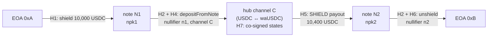

# Selective disclosure — proving a chain of custody

design · 2026-10-15 · proposed ([ADR-0020](./09-architecture-decisions.md#adr-0020))

## What this decides

How a user proves to a third party where specific shielded value came from and where it went, and reveals nothing else about the wallet.

A user can already prove ownership of a public address with an ordinary signature. Inside the pool, no public record links a spend to the note that it spent. This page defines the proofs that restore that link for the notes that the user chooses, and only for those notes.

The protocol is voluntary and off-chain. It changes no pool contract, no pool circuit and no armada-nitro contract. One new component is necessary: a small **disclosure circuit** (see [The disclosure circuit](#the-disclosure-circuit)).

## The problem

The pool hides three things: the owner of each note, the note that each spend consumes, and the value of each output that stays shielded. The public record shows:

| Event | Public data |
|---|---|
| `Shield` | The note preimage: `npk`, token, value. The transaction sender. |
| `Transact` | The output commitment hashes and their ciphertexts. |
| `Nullified` | The nullifiers of the spent notes. |
| `Unshield` | The recipient, token and amount. |

A nullifier is `Poseidon(nullifyingKey, leafIndex)` (`armada-circuits/src/operations/Transact.circom`, step 2d). Nobody can connect a nullifier to its note without the `nullifyingKey`. That is the property that makes the pool private.

The `nullifyingKey` is not a good disclosure tool. With it, a verifier can compute the nullifier of every leaf in the tree and compare them with all published nullifiers. The verifier then sees every spend that the wallet ever made. Rotation of the key limits this scope but does not remove it, and each rotation adds a migration transaction and one more step to the proof chain. The disclosure circuit proves one link and keeps the key secret.

## Key facts the protocol uses

From `armada-circuits/src/operations/Transact.circom` and `armada-sdk/vendor/railgun-engine/src/key-derivation/wallet-node.ts`:

- `masterPublicKey = Poseidon(spendingPublicKeyX, spendingPublicKeyY, nullifyingKey)`. The 0zk address carries the `masterPublicKey`.
- `nullifyingKey = Poseidon(viewingPrivateKey)`.
- `npk = Poseidon(masterPublicKey, random)`. Each note has its own `random`. The owner knows it, and nobody else does.
- `commitment = Poseidon(npk, token, value)`.
- `nullifier = Poseidon(nullifyingKey, leafIndex)`.
- Each spend carries an EdDSA signature by the spending key over the proof's public inputs, which include `boundParamsHash`.

## The hops

A disclosure is a chain of **hops**. Each hop links two public facts. The verifier checks each hop on its own.

| Hop | From → to | Evidence | New component? |
|---|---|---|---|
| H1 · Address shields note | EOA → note | The `Shield` event shows `npk`. The user discloses `masterPublicKey` and `random`, and the verifier checks `npk = Poseidon(masterPublicKey, random)`. The EOA signs the statement. | No |
| H2 · Note is spent | note → spend transaction | A disclosure proof that a published nullifier belongs to the note at a given leaf, for the disclosed `masterPublicKey`. | **Yes: the disclosure circuit** |
| H3 · Spend creates note | spend → output note | The user opens the output commitment: `npk`, token, value and `random`. The verifier recomputes the hash and compares it with the `Transact` event. | No |
| H4 · Spend funds a channel | spend → armada-nitro channel | `depositFromNote` requires `adaptParams == depositBinding(channelId, expectedHeld)` (`armada-nitro/src/ArmadaNitroAdjudicator.sol`). The spend proof commits to `boundParamsHash`, so the spending key authorized this channel. The adjudicator emits `Deposited(channelId, asset, held)`. | No |
| H5 · Channel pays a note | channel → payout note | The finalized outcome has a `SHIELD` allocation whose `destination` is the payout `npk`. The pool's `Shield` event in the same transaction shows the note. The user opens the `npk` as in H1. | No |
| H6 · Note leaves the pool | note → EOA | H2 for the spent note, plus the `Unshield` event to the recipient EOA. The recipient EOA signs the statement. | No (uses H2) |
| H7 · Channel gain is attributed | channel deposit → channel payout | The co-signed states of the channel, from the state after the deposit to the finalized state. Required when the statement claims how the channel's gain arose; see [Attribution](#attribution). | No |

H2 is the only hop that needs new cryptography. All the other hops use data that is already public or that the user already holds.

## The disclosure circuit

**Statement.** "I hold the keys of the wallet with `masterPublicKey` M. The nullifier N belongs to the leaf at `leafIndex` L in tree T. The spending key of M authorizes the statement hash S for this nullifier."

| Input | Visibility | Constraint |
|---|---|---|
| `masterPublicKey` M | public | `M == Poseidon(Ax, Ay, nullifyingKey)` |
| `nullifier` N | public | `N == Poseidon(nullifyingKey, L)` |
| `leafIndex` L, `treeNumber` T | public | Each fits in 16 bits. The verifier checks off-circuit that the disclosed commitment is at (T, L), and that N is in the pool's `Nullified` event for tree T. |
| statement hash S | public | — |
| (Ax, Ay), signature (R8, Ssig) | private | Both points are on BabyJubJub. The EdDSA signature by (Ax, Ay) over `Poseidon(S, M, N, T, L)` verifies. |
| `nullifyingKey` | private | — |

The circuit needs no Merkle path, because the leaf position is public in the `Shield` and `Transact` events. It is a few Poseidon hashes and one EdDSA check: 8,248 non-linear and 1,835 linear constraints.

**Why the circuit checks the spending key.** The `nullifyingKey` derives from the viewing key. A holder of the viewing key alone, such as an auditor or a compromised device, could prove N without the signature check. With the signature check, only the holder of the spending key can make a disclosure.

**Why the signed message includes every public input.** In Groth16, a public input that no constraint uses is not bound by the proof. The message hash uses all five public inputs, so the proof binds each of them. It also stops a holder of the viewing key from reusing an old signature with a different nullifier. T is in the message because the same `nullifyingKey` and leaf index give the same nullifier in every tree.

**Why S is public.** S is the hash of the full disclosure statement: the verifier, a context string, the list of hops and the EOA addresses. A proof for one statement cannot be reused in another statement.

**Implementation.** `armada-circuits`: `src/operations/NullifierDisclosure.circom`, with tests in `tests/disclosure.test.js`. The circuit is under review in [ship-armada/armada-circuits#3](https://github.com/ship-armada/armada-circuits/pull/3).

**Verification status.**

| Part of the circuit | Evidence | Kind |
|---|---|---|
| Our wiring: the range checks, the equality checks, the on-curve checks and the message routing | Picus with cvc5, strong safety, with the hashes and the verifier replaced by free inputs: properly constrained, given a full assignment to the piece's declared inputs. Picus does not use the public/private split of inputs for any circuit. | Proof of uniqueness |
| `Poseidon(2)`, `Poseidon(3)`, `Poseidon(5)` | Picus with cvc5, weak safety: properly constrained | Proof of uniqueness |
| circomlib `EdDSAPoseidonVerifier` | Rejection tests for another signer, another statement, a public input changed after signing, `S` plus the subgroup order, and a forged signature for a small-order key | Tests only |
| The whole circuit against the statement above | 18 tests: parity with the armada-sdk engine vectors, the 9 captured spends, acceptance, rejection and a Groth16 round trip | Tests only |

Picus did not finish on `EdDSAPoseidonVerifier`, because cvc5 does not terminate on its scalar multiplications. No published work proves this template either. Coda (Veridise, IEEE S&P 2024) proves that its constraints imply the EdDSA verification equation. That proof treats point doubling, point addition and scalar multiplication as axioms, and it models no check for `S` < subgroup order or for `A` ≠ 0. So the verifier stays a trusted circomlib component, as it is for `Transact.circom`.

A formal proof in Lean that the circuit's constraints are equivalent to the statement, relative to a specified EdDSA verifier, is planned work at low priority.

## Key binding between EOAs and the shielded wallet

The hops start and end at public addresses. So the statement binds each EOA to M in both directions:

- the EOA signs S (EIP-712), and S names M;
- the spending key of M signs S inside the disclosure circuit, and S names the EOA.

A key holder on only one side cannot make the binding alone.

## Chain scope

The statement's EIP-712 domain names one chain and one pool. The statement also names the armada-nitro adjudicator when it has an H4, H5 or H7 hop. The verifier accepts an event only when it comes from that chain and from that pool or adjudicator. A package that cites an event from any other chain or contract fails.

## Attribution

Without attribution, a verifier learns the amounts that went into a channel and came out of it, but not why they differ. An attribution states how the gain of one channel arose, for example yield from a `waUSDC` holding at the quoted rates.

A statement either claims an attribution for a channel or it does not. There is no optional evidence:

- **The statement claims an attribution.** The package must contain the co-signed states of that channel (hop H7). The verifier checks every one of them. The verifier reports each change to the user's allocation: the state, the asset, and the amount before and after.
- **The statement claims no attribution.** The package contains no channel states. The verifier reports only the deposit and payout amounts, and states no reason for a difference.

For H7, the verifier checks:

1. The states' fixed part gives the channel id C of the H4 hop.
2. The statement names the user's channel participant address. That address signs the statement (EIP-712), as an endpoint EOA does.
3. Every state carries the signatures of all participants. The user's signature recovers to the named participant address. The hub's signature passes `HubCustodian.isValidSignature` (EIP-1271) at a block where the hub's delegate was active.
4. The turn numbers increase from state to state.
5. The first state allocates to the user the amount of the H4 deposit. The last state's outcome equals the finalized outcome on chain (H5).

## Example: Aave yield through an armada-nitro hub

Alice shields USDC, earns Aave yield through a hub channel as `waUSDC` ([page 15](./15-hub-yield-and-swaps.md)), and withdraws to a new address. She then proves to an exchange that the withdrawn USDC is her own principal plus yield. The numbers are illustrative.

1. **Shield.** Alice's EOA `0xA` shields 10,000 USDC. The `Shield` event shows `npk1` and the note value after the shield fee.
2. **Fund the channel.** Alice spends N1 through `depositFromNote(C, expectedHeld, [tx])`. A broadcaster can submit it, so the transaction sender is not Alice. The transaction publishes the nullifier `n1` and the binding to channel C.
3. **Earn yield.** Alice and the hub co-sign a swap state: her USDC allocation goes to the hub, and an equal value of `waUSDC` shares goes to her at the rate that the hub quoted. Later, a second co-signed state swaps the shares back to USDC at the new, higher rate. The difference is the Aave yield. The hub keeps its Aave position outside the channel (page 15, I7).
4. **Close.** The channel finalizes with a `SHIELD` allocation of 10,400 USDC to `npk2`. The pool's `Shield` event shows the note N2 (value after the shield fee).
5. **Withdraw.** Alice unshields N2 to her new EOA `0xB`. The transaction publishes the nullifier `n2` and an `Unshield` event to `0xB`.

**The disclosure package.**

| Item | Proves |
|---|---|
| Statement S: verifier, context, chain, pool, adjudicator, hops, attribution claim for C, `0xA`, `0xB`, Alice's participant address, M | What Alice claims |
| EIP-712 signatures over S by `0xA`, `0xB` and Alice's participant address | Alice controls both EOAs and her side of channel C |
| `random1`, `random2` | N1 and N2 belong to M (H1, H5) |
| Disclosure proofs for `n1` and `n2` | N1 funded channel C, and N2 left the pool to `0xB` (H2) |
| Transaction hashes of the shield, the deposit, the conclude and the unshield | The verifier finds the events (H4, H5, H6) |
| The co-signed states of channel C, and the signature of Alice's participant address over S | The 400 USDC gain is yield from the `waUSDC` holding, at the quoted rates (H7). Required, because Alice's statement claims this attribution. |

**What the verifier checks.**

1. The three EIP-712 signatures over S, and that every cited event comes from the chain, pool and adjudicator that S names.
2. `npk1 = Poseidon(M, random1)` against the `Shield` event of step 1.
3. The disclosure proof for `n1`, and that `n1` is in the `Nullified` event of the deposit transaction.
4. The deposit transaction's `adaptParams` equals `depositBinding(C, expectedHeld)`, and `Deposited(C, USDC, …)` is in the same transaction.
5. The finalized outcome of C pays `npk2`, and `npk2 = Poseidon(M, random2)`.
6. The disclosure proof for `n2`, and the `Unshield` event to `0xB` in the same transaction.
7. The H7 checks for channel C, because Alice's statement claims an attribution.

**What the verifier learns:** the four transactions, the amounts at the deposit and the payout, channel C, the hub, `0xA`, `0xB`, M, and the two swaps in channel C with their rates.

**What the verifier does not learn:** any other note of Alice's wallet, any other spend, her balance, her viewing key or her `nullifyingKey`.

**The source of the yield.** The proof shows that Alice's principal came from her shield and that her payout returned to her wallet. The 400 USDC above the principal is the hub's money. The hub paid it into her allocation from its own `waUSDC` and USDC inventory. The H7 states show that it is yield at the quoted rates.

## Limits

- **An attribution covers only signed states.** H7 shows what the user and the hub agreed in co-signed states. It does not show the hub's reasons, or prices outside the channel.
- **A received note ends the chain.** If a note came from another user, the user can open it (H3) but cannot prove the sender's history. The sender must make their own disclosure.
- **The package can be forwarded.** The verifier can pass the package to others, and each one can check it. This is necessary for an audit record. S names the verifier and the context, so the package states for whom and for what the user made it.
- **Disclosed data is permanent.** After disclosure, M links the package to the user's 0zk address, and `random1` and `random2` open N1 and N2 for anyone who holds the package.

## WalletConnect

WalletConnect Wallet Verification (`walletconnect.com/compliance/wallet-verification`) is complementary to this protocol and compatible with it. It verifies the public addresses at the ends of the chain. This protocol covers the shielded part between them.

## Policy

Disclosure is voluntary. It is the application-layer tooling that `armada-poc/specs/GOVERNANCE.md` §Pool access conditions permits. It must never become a condition to deposit into, transfer in, or withdraw from the pool.

## Open

- **The proof system for the disclosure circuit.** Groth16 needs its own Phase-2 ceremony (as in [ADR-0003](./09-architecture-decisions.md#adr-0003)). A universal-setup system avoids the ceremony. The circuit is small, so the proving cost is low in both cases.
- **The package format** and its encoding (EIP-712 domain, statement schema, serialization).

The SDK builds and checks disclosure packages. A client app uses the SDK and holds no disclosure logic of its own.

## Where this fits

- Hub yield and swaps: [15](./15-hub-yield-and-swaps.md). Hub channels and games: [14](./14-shielded-games-over-nitro.md).
- Settlement rail: [A.5 deposit/payout contract](./A-nitro-on-railgun/A.5-deposit-payout-contract.md). Anonymity set: [A.7](./A-nitro-on-railgun/A.7-anonymity-set.md).
- Decisions: [ADR-0016](./09-architecture-decisions.md#adr-0016) (adjudicator and custodian), [ADR-0017](./09-architecture-decisions.md#adr-0017) (hub yield), [ADR-0020](./09-architecture-decisions.md#adr-0020) (this design).
